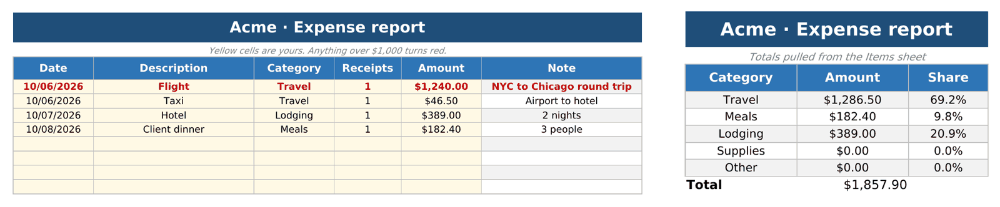

# office-templates

Describe a spreadsheet in YAML, get an `.xlsx` with working formulas, dropdowns, conditional formatting and totals. Pure Python on top of openpyxl; Excel is not needed to build the files.

[](https://github.com/racio-dio/office-templates/actions/workflows/ci.yml)
&nbsp;[中文说明](README.zh-CN.md)


That command turns [`examples/specs/expense-report.yaml`](examples/specs/expense-report.yaml) into this workbook. The category sheet is SUMIFS over the items sheet, and any line over $1,000 is flagged:



## Quick start

Python 3.9 or newer.

```bash
pip install git+https://github.com/racio-dio/office-templates
office-templates --spec examples/specs/expense-report.yaml -c "Acme" -o out/
```

Or from a clone, without installing:

```bash
git clone https://github.com/racio-dio/office-templates
cd office-templates
pip install -r requirements.txt
python build.py --spec examples/specs/expense-report.yaml -o out/
```

Open `out/expense-report.xlsx`. Yellow cells are input; everything else is computed.

## Writing a template

A spec is a file name, a title and a list of sheets. Each sheet is a list of columns:

```yaml
filename: expense-report.xlsx
title: Expense report
subtitle: Yellow cells are yours. Anything over $1,000 turns red.

sheets:
  - name: Items
    rows: 30
    freeze: A4
    totals: true
    columns:
      - {label: Date, type: date, format: mm/dd/yyyy, fill: FFF9E5}
      - {label: Category, choices: [Travel, Meals, Lodging, Supplies, Other], fill: FFF9E5}
      - {label: Amount, type: number, format: "$#,##0.00", total: true, fill: FFF9E5}
      - {label: Note, width: 24}
    conditionals:
      - range: "A{r1}:D{last}"
        when: "$C{r1}>1000"
        font_color: C00000
        bold: true

  - name: By category
    rows: 5
    totals: true
    columns:
      - {label: Category, sample: [Travel, Meals, Lodging, Supplies, Other]}
      - {label: Amount, format: "$#,##0.00", total: true,
         formula: "=SUMIFS(Items!$C:$C,Items!$B:$B,A{r})"}
      - {label: Share, format: "0.0%", formula: "=IFERROR(B{r}/$B${total},0)"}
```

`{r}` is the current row, `{r1}` the first data row, `{last}` the last one and `{total}` the totals row. Every sheet comes out set to print one page wide.

## Reference

### Fields

| Level | Field | Meaning |
|---|---|---|
| root | `filename` | output name, must end with `.xlsx` |
| | `title` / `subtitle` | heading and subheading (overridable per sheet) |
| | `sheets` | list of sheets, at least one |
| sheet | `name` / `columns` | sheet name and its columns (required) |
| | `header_row` / `rows` | header row (default 3), data rows (default 30) |
| | `freeze` | freeze panes, e.g. `A4` |
| | `totals` | add a totals row, summing columns marked `total: true` |
| | `conditionals` | conditional formatting rules |
| | `total_label` | text in the totals row (default: `Total`, or `合计` for Chinese sheets) |
| column | `label` | column heading (required) |
| | `type` | `text` (default) / `number` / `date` |
| | `width` / `format` | column width, number format |
| | `formula` | formula with placeholders (used instead of `sample`) |
| | `choices` | dropdown options |
| | `sample` | example values, filled row by row |
| | `fill` | background colour (`FFF9E5` marks an input area) |
| | `total` | include in the totals row |
| conditional | `range` / `when` | target range and condition, placeholders allowed |
| | `font_color` / `fill` / `bold` | styling when it matches |

### Placeholders

Usable in `formula`, `range` and `when`:

| Placeholder | Resolves to |
|---|---|
| `{r}` | current data row |
| `{r1}` | first data row |
| `{last}` | last data row |
| `{total}` | totals row (same as `{last}` when `totals` is off) |

A bad definition stops with a message that names the field, and exit code 2. Typos in placeholders, duplicate or over-long sheet names, header rows that collide with the title, and dropdown lists Excel would reject are all caught before anything is written.

## Command line

```
office-templates [options]        # or: python build.py [options]
```

| Option | What it does |
|---|---|
| `--spec <file...>` | build from YAML or JSON specs |
| `-o, --out-dir <dir>` | output directory (default `dist/`) |
| `-c, --company <name>` | prefix every title with a company name |
| `-t, --only <...>` | build only these built-ins, by number or key |
| `-l, --list` | list the built-ins |
| `--lang en\|zh` | interface language (also `OFFICE_TEMPLATES_LANG`) |
| `-q, --quiet` | errors only |
| `-V, --version` | print version |

Exit codes: 0 on success, 2 for bad input, 1 when a file can't be written.

## Use it from Python

```python
from office_templates import Options, load_spec, render_spec

wb = render_spec(load_spec("my.yaml"), Options(company="Acme"))
wb.save("my-template.xlsx")
```

## Built-in templates (Chinese)

Run with no `--spec` and you get five built-in workbooks: attendance, payroll with payslips, a Gantt chart, a household budget and inventory. They have Chinese labels and follow Chinese payroll rules (social insurance, housing fund, progressive income tax), so they are mainly useful as larger examples of what the engine can do. Parameters such as `--staff`, `--departments`, `--year`, `--month` and `--start-date` apply to them; see `office-templates --help`.

## Project layout

```
office-templates/
├── build.py                    # CLI entry point
├── office_templates/
│   ├── options.py              # parameters (company, staff, rates…)
│   ├── spec.py                 # YAML/JSON definition → dataclasses
│   ├── render.py               # definition → Workbook
│   ├── i18n.py                 # zh/en interface strings
│   ├── styles.py               # colours, title/header/body helpers
│   ├── registry.py             # built-in registry, selection, saving
│   ├── cli.py                  # argparse CLI
│   └── templates/              # built-ins, one module each
├── examples/
│   ├── params.json             # parameter file example
│   ├── staff.txt               # name list example
│   └── specs/                  # YAML template definitions
├── docs/                       # README images
├── tests/                      # smoke, spec and validation tests
└── .github/workflows/ci.yml    # CI on Python 3.9 / 3.11 / 3.13
```

Building the built-ins from Python:

```python
from office_templates import Options, build_templates, resolve

opts = Options(company="Acme", staff=("Alice", "Bob"), month=11)
build_templates(resolve(["kaoqin", "gongzi"]), "./out", opts)
```


## Development

```bash
pip install -r requirements.txt pytest
python -m pytest
```

CI runs the tests on Python 3.9, 3.11 and 3.13 and uploads the generated workbooks as an artifact.

## License

MIT
